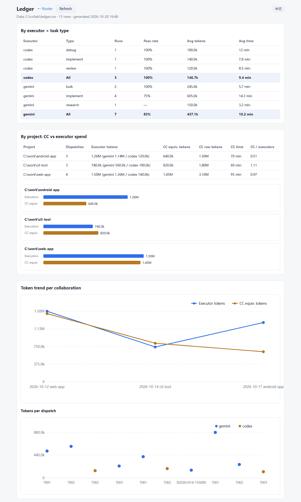
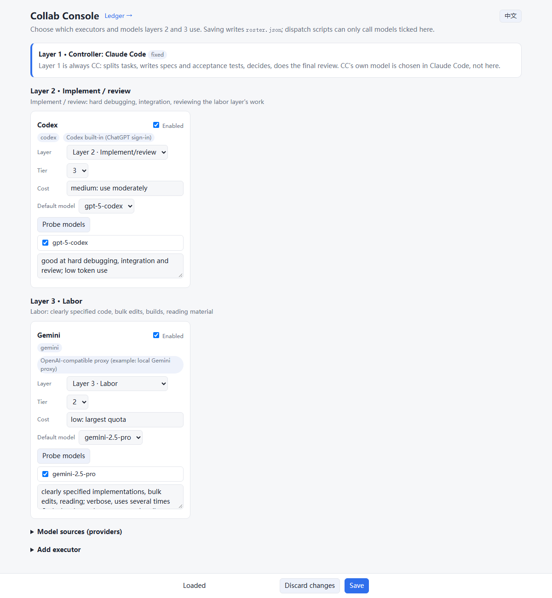

# collab: a three-agent workflow orchestrated by Claude Code (CC + Gemini + Codex)

**English** | [简体中文](README.zh-CN.md)

Let Claude Code (CC) do only the thinking — planning, writing specs, reviewing — and hand the actual coding, bulk edits and reading to cheaper executors (Gemini / Codex). This saves a large share of your CC quota.

- CC splits the work, writes a spec and an **executable acceptance test** for each task, then dispatches it in the background;
- Executors work inside the Codex CLI sandbox and must pass the acceptance test before handing in;
- A pipeline automatically runs "test → rework on failure → escalate to a stronger executor", and wakes CC only once per batch;
- Every dispatch is logged to a ledger (tokens, time, pass rate), so the next task goes to whoever performs best.

> Platform: Windows + PowerShell 7 (pwsh). Executors run through the [Codex CLI](https://github.com/openai/codex).
>
> **Languages:** English (default) and Simplified Chinese. The skill, task/report templates, executor instructions and generated text all come in both. Choose with `"language": "en" | "zh-CN"` in `roster.json` (or the `COLLAB_LANG` environment variable). Task files written in either language are parsed regardless of the setting.



*The ledger page of the built-in console (sample data).*



*The roster console: pick executors and whitelist models per layer (sample config).*

## Install

1. Clone anywhere, e.g. `C:\collab`, and point the user environment variable `COLLAB_HOME` at it:
   ```powershell
   git clone https://github.com/azakmo/collab-skill C:\collab
   [Environment]::SetEnvironmentVariable('COLLAB_HOME', 'C:\collab', 'User')
   ```
2. Install the skill into Claude Code (English; use `skill\zh-CN\collab` for Chinese):
   ```powershell
   Copy-Item -Recurse C:\collab\skill\en\collab "$env:USERPROFILE\.claude\skills\"
   ```
3. Install and sign in to the Codex CLI (`codex` on PATH, or the Codex desktop app installed).
4. Configure the roster: on first run `roster.example.json` is copied to `roster.json`. Open the console, click "Probe models" and tick the models you actually have (the model names in the example are placeholders):
   ```powershell
   pwsh -File "$env:COLLAB_HOME\console\console.ps1"
   ```
5. If you use an OpenAI-compatible endpoint (e.g. a local Gemini proxy) as an executor: put the key in a **user environment variable** and write only the variable name in the roster provider (the example uses `AGT_API_KEY`). The endpoint must support the `responses` wire format (required by the Codex harness).

Then tell Claude Code **"collab mode"** / **"please collaborate"** (or 「请协同处理」) to use the workflow; otherwise CC does the work itself.

## Roles

| Layer | Default | Responsibilities |
|---|---|---|
| 1 · Controller | Claude Code (CC), fixed | Split tasks, write specs and acceptance tests, decide, **final review** |
| 2 · Implement / first review | Codex | Hard debugging, integration, tasks that are hard to specify, reviewing layer 3 when tests can't cover it |
| 3 · Labor | Gemini: Codex CLI as harness + OpenAI-compatible proxy | **Most of the code** (clearly specified, with tests), bulk edits, builds, reading material |
| Final sign-off | You | Anything touching real environments (servers / deploys / sending to others): CC reviews, then you approve |

Which executors and models actually sit in layers 2 and 3 is whatever the console saved to `roster.json`.
Review chain: executor self-check (runs the test) → `verify.ps1` → Codex review if needed → CC final review → your approval for real-environment actions.

## Layout

```
$COLLAB_HOME\
  README.md            this file (README.zh-CN.md: Chinese)
  skill\en\collab\     Claude Code skill, English (copy to ~/.claude/skills/)
  skill\zh-CN\collab\  Claude Code skill, Chinese
  templates\en\        task / report / board templates (English)
  templates\zh-CN\     same, Chinese
  bin\
    init-collab.ps1    create collab\ inside a project
    run-executor.ps1   generic dispatcher (roster.json whitelist)
    run-codex.ps1      = run-executor -Executor codex
    run-gemini.ps1     = run-executor -Executor gemini
    run-pipeline.ps1   one task: dispatch → verify → rework → escalate
    run-batch.ps1      several pipelines in parallel, one summary
    verify.ps1         run the task's acceptance test
    ask.ps1            delegate reading / log digging / research
    ledger-mark.ps1    record CC's verdict in the ledger
    cc-usage.ps1       measure CC's own token spend
    tools.ps1          shared helpers (codex.exe lookup, whitelist, ledger, toolchains)
  executor\            AGENTS.md (+ AGENTS.zh-CN.md) and on-demand skills injected into executors
  console\             web console (console.ps1 + console.html + ledger page + i18n.js)
  roster.example.json  roster example (roster.json is local, git-ignored)
  ledger.csv           ledger (local, git-ignored)

<project>\collab\
  brief.md             goal, constraints, acceptance criteria (CC)
  board.md             task board: id, executor, status (CC)
  tasks\T001.md        one task (CC)
  reports\T001.md      report (executor)
  logs\                run logs (scripts)
```

## Rules

1. Before dispatching, CC writes the task file: executor, inputs, **files allowed to change**, deliverables, acceptance criteria.
2. One file is owned by one executor at a time. In git repos, use separate worktrees for parallel code changes.
3. Executors touch local files only: **no SSH, no servers, no deploys, no messages, no deleting anything outside `collab\`**. Those actions are CC's, after asking you.
4. Don't delegate small jobs: anything CC can finish in ≤ 3 tool calls, CC does itself.
5. Fire and forget: run in the background and wait for the completion notice; no log peeking or progress checks.
6. Write the "规格" (spec) section in detail — interfaces, examples, edge cases, don'ts — and attach an acceptance test.
7. Reports must state: where the output is, what changed, verification command and result, what's unfinished.
8. CC's final review looks at real output (run it, diff, spot-check), not just the report.
9. At most two rework rounds per task, then re-split or switch executor.

## Usage

```powershell
# 1. Create the collab folder in a project
& "$env:COLLAB_HOME\bin\init-collab.ps1" -Project 'C:\work\my-project'

# 2. CC writes collab\brief.md and collab\tasks\T001.md, updates board.md

# 3. Dispatch (pipeline recommended, run in background)
& "$env:COLLAB_HOME\bin\run-batch.ps1" -Project 'C:\work\my-project' -Tasks T001,T002

# 4. Read collab\reports\T00x.md + the real output, final review
```

### Pipeline: auto-verify, rework, escalate (run-pipeline / run-batch)
- `run-batch.ps1 -Project <dir> -Tasks T001,T002 [-MaxRework 2]`: runs tasks in parallel and prints one summary table at the end (result, who finished it, attempts, tokens, minutes).
- Per task (`run-pipeline.ps1`): dispatch → run the acceptance test → on failure append the failing lines to the task file and send it back to the same executor (up to MaxRework rounds) → still failing: hand it to the next executor in `Escalation` → result in `collab/logs/<task>.pipeline.json`.
- Settings are read from the task file fields: `Executor`, `Timeout`, `Network`, `Toolchain`, `Escalation` (or the Chinese `执行者`, `时限`, `联网`, `工具链`, `升级路径`).
- Results: `PASS`; `NO_TEST` (no acceptance test, CC reviews manually); `NEEDS_CC` (the whole escalation path failed).
- Executors run with a lean config (`--ignore-user-config`, no Codex plugins / MCP servers / hooks), measured at 20–30% fewer baseline tokens. Set `clean_config: false` in the roster to opt out; `reasoning` sets reasoning effort.
- **Dedicated executor environment** (on by default, `collab_env: false` to opt out): `-c skills.include_instructions=false` hides your personal Codex skill list, and `-c developer_instructions` injects `executor\AGENTS.md` (with `{{COLLAB_HOME}}` replaced by the real path): sandbox limits, PowerShell pitfalls, working style, and on-demand skills under `executor\skills\*\SKILL.md`. Login and sandbox setup stay in your normal `CODEX_HOME`.
  - `executor\AGENTS.md` must not contain `'''` (it is passed as a TOML literal string).
  - Add recurring generic pitfalls to `executor\AGENTS.md`; longer recipes go into `executor\skills\<name>\SKILL.md`, listed at the end of AGENTS.md. Keep it short.

### CC's own spend (cc-usage.ps1)
- `& "$env:COLLAB_HOME\bin\cc-usage.ps1" -Since '<start time>' [-Record -Project <dir> -Task 'CC(total)']`: reads Claude Code transcripts (`~/.claude/projects/*.jsonl`) and reports calls, average context, token types and a price-weighted equivalent (equiv); `-Record` adds it to the ledger as `executor=cc`.

### Console and roster (roster.json)
- Start: `pwsh -File "$env:COLLAB_HOME\console\console.ps1"` → opens http://localhost:8790/ (localhost only, Ctrl+C to quit). `/ledger` shows ledger statistics. The UI is bilingual: it starts in the configured language, and the English / 中文 button in the top-right switches it (remembered per browser).
- Choose which executors sit in layer 2 (implement/review) and layer 3 (labor) and which models are enabled; saved to `roster.json` (previous version backed up as `roster.json.bak`).
- Probe models: Codex built-in models come from `models_cache.json`; OpenAI-compatible endpoints from `/models`.
- New provider: enter the URL and the **name of an environment variable** holding the key (the console never accepts or shows keys).
- **The whitelist is enforced**: `run-executor.ps1` only allows enabled executors and ticked models; anything else fails before any call is made.
- Capability tier 1–3: if a task's `Difficulty` exceeds the executor's tier, the dispatcher prints a WARNING.

### Acceptance tests (verify.ps1)
- Every task file needs an `## Acceptance test` (or `## 验收测试`) section: a PowerShell block with one `Check` per criterion, exit code 0 when all pass. Executors must pass it before handing in and may not modify it.
- Host-only checks (starting an HTTP server, opening a browser, listening on ports) use `HostCheck`: inside the executor sandbox they print `SKIP [host]` and don't count as failures; the pipeline runs them on the host. The sandbox is detected by the user name `codexsandbox*`; if detection fails, `HostCheck` behaves like `Check`, so nothing is skipped silently.
- Dry-run the test before dispatching (before the deliverable exists) and make sure every failure is "not written yet", not a broken test. Call GUI programs (msedge etc.) with `Start-Process -Wait -RedirectStandardOutput`, not `&`.
- First step of the final review: `& "$env:COLLAB_HOME\bin\verify.ps1" -Project <dir> -Task T00n -Mark` — prints a few PASS/FAIL lines; `-Mark` records pass/rework in the ledger.

### Delegate reading and research (ask.ps1)
```powershell
& "$env:COLLAB_HOME\bin\ask.ps1" -Project <dir> -Question 'question to answer' [-Files a,b] [-Network] [-Executor gemini|codex] [-MaxWords 400]
```
Creates a research task `collab\tasks\R<timestamp>.md`, sends it to an executor (Gemini by default), and prints only the report: conclusion first, then sources (`file:line` or URL). CC reads only that report and spot-checks one or two sources.

### Ledger (ledger.csv)
- Each dispatch appends a row: time, project, task, type, executor, model, flags, exit code, minutes, tokens, self-reported status (UTF-8 with BOM, opens in Excel).
- Record the verdict after review: `& "$env:COLLAB_HOME\bin\ledger-mark.ps1" -Project <dir> -Task T00n -Review pass|rework|failed|cancelled [-Note 'reason']`.

### Network and toolchains
- `-Network`: allow network access inside the sandbox (dependencies, sources, builds). Off by default; enable per task and list the allowed official sources in the task's `Network` field.
- `-Toolchain android`: sets env vars and PATH for JDK / Android SDK+NDK / Go / Gradle. **The paths in `$Toolchains` in `bin\tools.ps1` are examples — edit them for your machine**; add new toolchains there too.
- `-AddDir <dir>`: extra writable directories (caches outside the project).
- With network on, an executor can technically reach any address; only the task rules restrain it. Never delegate SSH, deploy or login work.

### About the Gemini proxy
- Layer 3 calls Gemini through an OpenAI-compatible (`responses` format) proxy; its URL and key variable are set in the roster provider. If the proxy isn't running, the scripts fail immediately.
- Risk: bulk calls through a third-party proxy may get your account restricted — assess this yourself.
- Proxies occasionally garble the conversation format, so don't skip the Codex review and CC's final review.

Exit codes: 0 = executor finished and wrote a report; 2 = finished without a report; 3 = timed out and killed; other = the executor's own error.

## License

MIT
