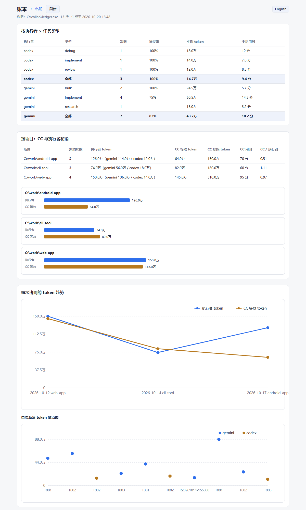

# collab：Claude Code 主控的三方协同框架（CC + Gemini + Codex）

[English](README.md) | **简体中文**

> 语言：支持英文（默认）和简体中文。技能、任务/回报模板、执行者守则和脚本生成的文字都有两套。在 `roster.json` 里设 `"language": "zh-CN"`（或环境变量 `COLLAB_LANG=zh-CN`）切换成中文。不论设置如何，中英文写的任务文件都能解析。

让 Claude Code（CC）只做"想清楚、写清楚、验收"，把写代码、批量修改、读资料交给更便宜的执行者（Gemini / Codex），从而大幅节省 CC 的额度。

- CC 拆任务、写规格和**可执行的验收测试**，然后后台派活；
- 执行者在 Codex CLI 的沙箱里干活，交活前自己跑验收测试；
- 流水线自动"跑测试 → 不过就返工 → 还不过就升级给更强的执行者"，一整批只叫醒 CC 一次；
- 每次派活自动记账（token、用时、通过率），下次按数据选执行者。

> 平台：Windows + PowerShell 7（pwsh）。执行者通过 [Codex CLI](https://github.com/openai/codex) 运行。



*控制台自带的账本页面（示例数据）。*

## 安装

1. 克隆到任意目录，例如 `C:\collab`，并设置用户环境变量 `COLLAB_HOME` 指向它：
   ```powershell
   git clone https://github.com/azakmo/collab-skill C:\collab
   [Environment]::SetEnvironmentVariable('COLLAB_HOME', 'C:\collab', 'User')
   ```
2. 把中文版技能装进 Claude Code，并把语言切成中文：
   ```powershell
   Copy-Item -Recurse C:\collab\skill\zh-CN\collab "$env:USERPROFILE\.claude\skills\"
   [Environment]::SetEnvironmentVariable('COLLAB_LANG', 'zh-CN', 'User')
   ```
3. 安装并登录 Codex CLI（`codex` 在 PATH 里，或装了 Codex 桌面版）。
4. 配置名册：首次运行会把 `roster.example.json` 复制成 `roster.json`。打开控制台，点「探测模型」后勾选实际可用的模型（示例里的模型名只是占位）：
   ```powershell
   pwsh -File "$env:COLLAB_HOME\console\console.ps1"
   ```
5. 如果用 OpenAI 兼容接口（比如本机的 Gemini 反代）当执行者：把密钥设进**用户环境变量**，在名册 provider 里只写变量名（示例为 `AGT_API_KEY`）。接口需要支持 responses 格式（Codex 执行壳的要求）。

之后在 Claude Code 里说 **「请协同处理」** 就会走这套流程；不说就由 CC 自己做。

## 角色

| 层 | 默认 | 负责 |
|---|---|---|
| 第一层 主控 | Claude Code（CC），固定 | 拆任务、写规格和验收测试、决策、**终审** |
| 第二层 实现/初审 | Codex | 难的排查、集成、规格难写清楚的活、测试覆盖不到时初审第三层 |
| 第三层 苦力 | Gemini：Codex CLI 当执行壳 + OpenAI 兼容反代 | **大部分代码**（规格清楚、有验收测试的）、批量修改、编译、读资料 |
| 最终确认 | 用户 | 凡是要动真实环境（服务器/部署/发给别人）的，CC 验收后再由用户点头 |

第二、三层实际用哪些执行者和模型，以控制台保存的 `roster.json` 为准。
验收链：执行者自检（跑验收测试）→ verify.ps1 → 必要时 Codex 初审 → CC 终审 → 涉及真实环境的由用户确认。

## 目录

```
$COLLAB_HOME\
  README.md            本文件
  skill\zh-CN\collab\  Claude Code 技能，中文（复制到 ~/.claude/skills/）
  skill\en\collab\     同上，英文
  templates\zh-CN\     任务、回报、看板模板（中文）
  templates\en\        同上，英文
  bin\
    init-collab.ps1    在某个项目里建 collab\ 目录
    run-executor.ps1   通用派活入口（按 roster.json 白名单）
    run-codex.ps1      = run-executor -Executor codex
    run-gemini.ps1     = run-executor -Executor gemini
    run-pipeline.ps1   单任务：派活 → 验收 → 返工 → 升级
    run-batch.ps1      多任务并行跑流水线，汇总一次
    verify.ps1         跑任务里的验收测试
    ask.ps1            读资料/查日志/搜资料交给执行者
    ledger-mark.ps1    记账本登记终审结论
    cc-usage.ps1       统计 CC 自己的 token 花销
    tools.ps1          公共函数（定位 codex.exe、白名单、记账、工具链）
  executor\            注入给执行者的 AGENTS.zh-CN.md（英文 AGENTS.md）和按需技能
  console\             协同控制台（console.ps1 + console.html + 账本页面 + i18n.js 双语文案）
  roster.example.json  名册示例（roster.json 本地生成，不入库）
  ledger.csv           记账本（本地生成，不入库）

<项目>\collab\
  brief.md             需求：目标、约束、验收标准（CC 写）
  board.md             任务看板：编号、执行者、状态（CC 维护）
  tasks\T001.md        单个任务（CC 写）
  reports\T001.md      回报（执行者写）
  logs\                运行日志（脚本写）
```

## 规则

1. 派活前 CC 写好任务文件：执行者、输入、**允许修改的文件**、交付物、验收条件。
2. 同一个文件同一时间只给一个执行者改。项目是 git 仓库时，并行改代码用独立 worktree。
3. 执行者只能动本地文件：**不连 SSH、不碰服务器、不部署、不发消息、不删 collab\ 以外的东西**。这类操作只由 CC 做，并先问用户。
4. 小活不派：CC 自己 3 次以内的工具调用能做完的，直接做。
5. 派出去就不盯：后台运行，等完成通知，中间不看日志、不查进度。
6. 任务说明里的「规格」一节写细（接口、示例、边界情况、不要做的事），并附验收测试。
7. 回报必须写：成果位置、修改清单、验证命令和结果、未完成项。
8. CC 终审看实际成果（运行、diff、抽查），不只看回报文字。
9. 同一任务最多返工两轮，之后重新拆分或换执行者。

## 用法

```powershell
# 1. 给项目建协作目录
& "$env:COLLAB_HOME\bin\init-collab.ps1" -Project 'C:\work\my-project'

# 2. CC 写 collab\brief.md、collab\tasks\T001.md，更新 board.md

# 3. 派活（推荐流水线，后台运行）
& "$env:COLLAB_HOME\bin\run-batch.ps1" -Project 'C:\work\my-project' -Tasks T001,T002

# 4. 读 collab\reports\T00x.md + 实际成果，终审
```

### 流水线：自动验收、返工、升级（run-pipeline / run-batch）
- `run-batch.ps1 -Project <目录> -Tasks T001,T002 [-MaxRework 2]`：多个任务并行跑，全部结束后输出一张汇总表（结果、最终由谁完成、尝试次数、token、用时）。
- 每个任务的流程（`run-pipeline.ps1`）：派活 → 跑验收测试 → 不过就把失败项追加到任务文件里，交回给同一个执行者返工（最多 MaxRework 轮）→ 还不过就按「升级路径」换下一个执行者 → 结果写进 `collab/logs/<任务>.pipeline.json`。
- 设置都从任务文件里读：「执行者」「时限」「联网」「工具链」「升级路径」。
- 结果码：`PASS`；`NO_TEST`（没写验收测试，CC 自己审）；`NEEDS_CC`（整条升级路径都没过）。
- 执行者默认用精简配置运行（`--ignore-user-config`，不加载 Codex 里的插件、MCP 服务和钩子），实测基础 token 少 20–30%。名册里 `clean_config: false` 可以关掉；`reasoning` 设推理强度。
- **执行者专用环境**（默认开，名册里 `collab_env: false` 可关）：`-c skills.include_instructions=false` 关掉用户个人 Codex 技能列表，再用 `-c developer_instructions` 注入 `executor\AGENTS.md`（其中的 `{{COLLAB_HOME}}` 会替换成实际目录）：沙箱限制、PowerShell 常见坑、工作方式，以及按需读取的技能 `executor\skills\*\SKILL.md`。登录和沙箱配置仍在原来的 `CODEX_HOME`。
  - `executor\AGENTS.md` 不能含 `'''`（它作为 TOML 字面量字符串传入）。
  - 新的通用坑记到 `executor\AGENTS.md`；成段的固定做法写成 `executor\skills\<名字>\SKILL.md`，并在 AGENTS.md 末尾登记。保持短小。

### CC 自己的花销（cc-usage.ps1）
- `& "$env:COLLAB_HOME\bin\cc-usage.ps1" -Since '<开始时间>' [-Record -Project <目录> -Task 'CC(全程)']`：从 Claude Code 的会话记录（`~/.claude/projects/*.jsonl`）里统计调用次数、平均上下文、各类 token，以及按价格折算的等效值（equiv），并记进记账本（executor=cc）。

### 协同控制台和名册（roster.json）
- 打开控制台：`pwsh -File "$env:COLLAB_HOME\console\console.ps1"`，会自动打开 http://localhost:8790/ ，只监听本机，按 Ctrl+C 退出。`/ledger` 是账本统计页面。界面中英双语：默认跟随语言设置，右上角的 English / 中文 按钮可以切换（浏览器会记住）。
- 第二层（实现/初审）和第三层（苦力）放哪些执行者、勾选哪些模型，都在控制台里选，保存到 `roster.json`（旧版本自动备份为 `roster.json.bak`）。
- 「探测模型」：Codex 自带的模型从 `models_cache.json` 读；OpenAI 兼容接口从 `/models` 读。
- 新增模型来源：填地址和**环境变量名**（密钥先设进用户环境变量，控制台不收、也不显示密钥）。
- **白名单是硬限制**：`run-executor.ps1` 只放行已启用的执行者和已勾选的模型，其他一律直接报错，不会发出调用。
- 能力等级 1–3：任务「评估」里的难度超过执行者等级时，派活脚本会打出 WARNING。

### 验收测试（verify.ps1）
- 每个任务文件都必须有「验收测试」一节：一段 PowerShell，每条验收条件写一个 `Check`，全部通过时退出码为 0。执行者交活前必须自己跑通，不准修改这段脚本。
- 只能在宿主机跑的检查（起 HTTP 服务、开浏览器、监听端口）用 `HostCheck`：执行者沙箱里输出 `SKIP [本机]`、不算失败，流水线在宿主机照常检查。沙箱按用户名 `codexsandbox*` 识别；识别不到时 `HostCheck` 和普通 `Check` 一样执行，不会漏检。
- 派活前先空跑一遍测试（产物还不存在时跑），确认每条失败都是因为"产物还没写"。调用 GUI 程序（msedge 等）用 `Start-Process -Wait -RedirectStandardOutput`，不要用 `&`。
- 终审第一步：`& "$env:COLLAB_HOME\bin\verify.ps1" -Project <目录> -Task T00n -Mark`，只输出 PASS/FAIL 几行；加 `-Mark` 自动在记账本里登记通过或返工。

### 读资料、查日志、搜资料交给执行者（ask.ps1）
```powershell
& "$env:COLLAB_HOME\bin\ask.ps1" -Project <目录> -Question '要回答的问题' [-Files a,b] [-Network] [-Executor gemini|codex] [-MaxWords 400]
```
脚本自动生成调研任务 `collab\tasks\R<时间>.md`，派给执行者（默认 Gemini），最后只输出回报：先给结论，再列出处（`文件:行号` 或 URL）。CC 只读这份回报，关键结论抽查一两处。

### 记账本（ledger.csv）
- 每次派活后自动追加一行：时间、项目、任务、类型、执行者、模型、开关、退出码、用时、token、自评状态（UTF-8 带 BOM，可直接用 Excel 打开）。
- 终审后登记结论：`& "$env:COLLAB_HOME\bin\ledger-mark.ps1" -Project <目录> -Task T00n -Review 通过|返工|失败|取消 [-Note '原因']`

### 联网与工具链
- `-Network`：沙箱内允许联网（下载依赖、源码、编译）。默认关闭，按任务开启，并在任务文件「联网」一栏写明允许的官方源。
- `-Toolchain android`：设置 JDK / Android SDK+NDK / Go / Gradle 的环境变量和 PATH。**`bin\tools.ps1` 里的 `$Toolchains` 路径是示例，按你的机器改**，新工具链也在那里加。
- `-AddDir <目录>`：额外的可写目录（项目外的缓存等）。
- 开了联网后，执行者在技术上能访问任何地址，靠任务守则约束。所以涉及 SSH、部署或登录的活不要派。

### 关于 Gemini 反代
- 第三层默认通过一个 OpenAI 兼容（responses 格式）的反代调用 Gemini，地址和密钥变量名在 `roster.json` 的 provider 里配置。反代没开时脚本会直接报错。
- 风险：用第三方反代批量调用可能有账号被限制的风险，请自行评估。
- 反代转换对话格式时偶尔会失真，所以 Codex 初审和 CC 终审不能省。

脚本退出码：0 = 执行者正常结束且写了回报；2 = 结束了但没写回报；3 = 超时被终止；其他 = 执行者自身报错。

## License

MIT
